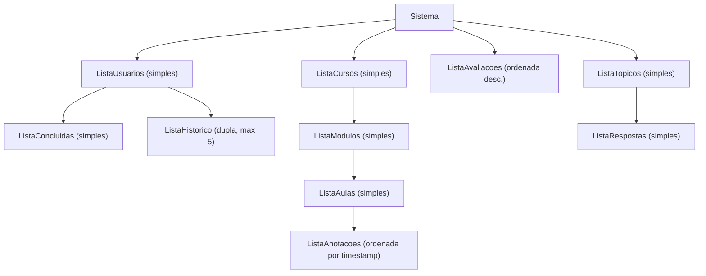

# Plataforma de Ensino a Distância (EaD)

[](https://en.cppreference.com/w/c/99)
[](#arquitetura-e-estruturas-de-dados)
[](https://inf.ufg.br/)
[](./RELATORIO_FINAL.md)

Sistema de terminal (CLI) para gestão de ensino a distância desenvolvido em **C99** para a disciplina de **Algoritmos e Estruturas de Dados 1**. Toda a lógica de dados é implementada manualmente com `struct`, ponteiros, alocação dinâmica (`malloc`/`free`) e listas encadeadas simples e duplas com descritores (`inicio`, `fim`, `tamanho`).

---

## Funcionalidades

### Perfil Docente
- **Gestão curricular hierárquica:** criar, listar, editar e excluir (em cascata) cursos, módulos e aulas/materiais complementares.
- **Avaliações e ranking:** lançar notas (0 a 10) mantidas automaticamente em ordem decrescente de desempenho (empates preservam ordem de chegada), com visualização geral ou filtrada por curso.
- **Gestão de usuários:** cadastrar, listar e excluir docentes/discentes com remoção em cascata de notas, anotações, tópicos e respostas órfãs.
- **Fórum colaborativo:** criar tópicos, responder dúvidas e moderar (excluir) tópicos.

### Perfil Discente
- **Grade curricular e histórico recente:** acessar aulas com registro automático em uma **lista duplamente encadeada limitada a 5 itens** (`MAX_HISTORICO = 5`, remoção pela cauda em `O(1)`).
- **Progresso acadêmico:** marcar aulas como concluídas e acompanhar progresso global e por módulo, contabilizando apenas aulas válidas (excluindo materiais complementares).
- **Anotações cronológicas:** criar, editar, listar e remover anotações por aula com timestamp `HH:MM:SS`, mantidas sempre em ordem crescente.
- **Exportação de caderno:** gerar o arquivo `caderno_aluno_<id>.md` contendo todas as anotações do aluno organizadas por curso, módulo e aula.
- **Busca linear filtrada:** pesquisar aulas por ID ou palavra-chave no título e buscar palavras-chave nas próprias anotações.
- **Ranking e fórum:** consultar o ranking da turma e participar de discussões nos tópicos dos cursos.

---

## Como Compilar e Executar

### Pré-requisitos
- Compilador C com suporte ao padrão **C99** (ex.: `gcc` / MinGW / MSYS2 / Clang).

### Compilação

**Linux / macOS:**
```bash
gcc -Wall -Wextra -std=c99 -pedantic -Iinclude src/*.c -o sistema
./sistema
```

**Windows (PowerShell / CMD com MinGW/MSYS2):**
```powershell
gcc -Wall -Wextra -std=c99 -pedantic -Iinclude src/anotacao.c src/avaliacao.c src/curso.c src/forum.c src/main.c src/persistencia.c src/usuario.c src/utils.c -o sistema.exe
.\sistema.exe
```

> [!IMPORTANT]
> Execute o binário sempre a partir da **raiz do repositório** para que o programa encontre corretamente os arquivos de persistência em `data/`.

---

## Credenciais de Teste

O repositório já inclui uma massa de dados pronta em `data/` (2 cursos, 4 módulos, 8 aulas válidas, 2 materiais complementares, 10 anotações, 5 avaliações, 3 tópicos e 4 respostas):

| Perfil | Nome | E-mail | Senha |
| :--- | :--- | :--- | :--- |
| **Docente** | Ana Paula | `prof@ufg.br` | `123` |
| **Discente** | Bruno Silva | `aluno1@ufg.br` | `123` |
| **Discente** | Carla Souza | `aluno2@ufg.br` | `123` |

> [!TIP]
> As alterações realizadas durante a sessão são gravadas automaticamente em `data/` a cada operação e também ao escolher **0) Sair e salvar** no menu inicial.

---

## Arquitetura e Estruturas de Dados

O estado em memória é centralizado na struct `Sistema` (`include/persistencia.h`), que agrega quatro listas encadeadas principais e suas sublistas:



### Estrutura de Diretórios

```text
.
├── include/               # Contratos (.h) das TADs e utilitarios
│   ├── anotacao.h         # Lista ordenada de anotacoes por timestamp
│   ├── avaliacao.h        # Lista ordenada de avaliacoes por nota (decrescente)
│   ├── curso.h            # Hierarquia Curso -> Modulo -> Aula e progresso
│   ├── forum.h            # Topicos e sublistas de respostas
│   ├── persistencia.h     # Struct Sistema, carga/gravacao, cascatas e exportacao .md
│   ├── usuario.h          # Usuarios, aulas concluidas e historico duplo (max 5)
│   └── utils.h            # Leitura segura (fgets) e conversao HH:MM:SS <-> segundos
├── src/                   # Implementacoes C99 correspondentes + main.c (CLI)
├── data/                  # 9 arquivos texto delimitados por '|'
└── RELATORIO_FINAL.md     # Relatorio tecnico detalhado e auditoria do projeto
```

---

## Persistência de Dados

Os dados são armazenados em `data/` usando arquivos de texto delimitados por `|` (compatíveis com finais de linha LF e CRLF). Na entrada via terminal, `ler_texto()` substitui automaticamente `|` por `-` e descarta excesso de buffer para preservar a integridade dos registros.

| Arquivo | Campos (`\|`) |
| :--- | :--- |
| `data/usuarios.txt` | `id\|nome\|email\|senha\|perfil` (`1` = docente, `2` = discente) |
| `data/cursos.txt` | `id_curso\|titulo\|descricao` |
| `data/modulos.txt` | `id_curso\|id_modulo\|titulo` |
| `data/aulas.txt` | `id_modulo\|id_aula\|titulo\|duracao_segundos\|eh_aula_valida` |
| `data/anotacoes.txt` | `id_aula\|id_anotacao\|id_aluno\|timestamp_segundos\|texto` |
| `data/concluidas.txt` | `id_usuario\|id_aula` |
| `data/avaliacoes.txt` | `id_avaliacao\|id_curso\|id_aluno\|titulo_atividade\|nota` |
| `data/topicos.txt` | `id_topico\|id_curso\|id_autor\|titulo\|pergunta` |
| `data/respostas.txt` | `id_topico\|id_resposta\|id_autor\|texto` |

> [!NOTE]
> Para detalhes de implementação das exclusões em cascata, auditoria de memória e exemplos completos dos arquivos em `data/`, consulte [RELATORIO_FINAL.md](RELATORIO_FINAL.md).
